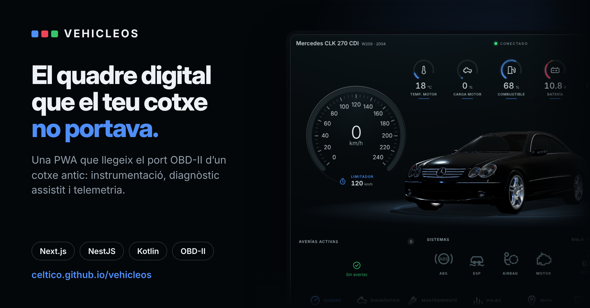

# VehicleOS



Sistema operativo para coches basado en una PWA. Funciona en pantallas Android de automóvil, tablets, móviles y navegadores web. Completamente modular.

## Arquitectura

```
apps/
  pwa             → Cockpit PWA (Next.js App Router, Tailwind, React Query, Zustand)
  landing         → Página de presentación (Next.js, exportación estática)
  backend         → API NestJS (REST + WebSocket, PostgreSQL + Prisma, JWT)
  android-bridge  → Servicio Android en Kotlin (único proceso con acceso al hardware)

packages/
  shared            → Tipos y contratos compartidos (telemetría, DTC, bridge JSON-RPC)
  vehicle-protocol  → Protocolo OBD-II / ELM327 (PIDs SAE J1979, decodificación DTC)
  vehicle-sdk       → Interfaz VehicleProvider + implementaciones (simulador, bridge, futuros)
  vehicle-simulator → Simulador físico con escenarios (arranque, ciudad, averías…)
  ui                → Componentes de instrumentación estilo Mercedes (60 FPS)
  telemetry         → Cliente de telemetría (lotes por WebSocket, cola offline)
  ai                → Base de conocimiento de DTC + cliente del asistente
  storage           → Almacenamiento local (IndexedDB con fallback en memoria)
```

### Regla de oro de seguridad

**La PWA nunca accede al hardware.** La cadena es siempre:

```
PWA → @vehicleos/vehicle-sdk → Vehicle Bridge (Android) → Bluetooth/BLE/USB/WiFi → OBD
```

- El **Vehicle Bridge** es un servicio Android sin interfaz, el único proceso con
  permisos de hardware. Expone una API JSON-RPC local (`ws://127.0.0.1:8722`).
- El **SDK** (`VehicleProvider`) es la única puerta de entrada de la PWA:
  `connect()`, `speed()`, `rpm()`, `coolant()`, `battery()`, `turbo()`, `fuel()`,
  `dtc()`, `clearDtc()`, `live()`, `disconnect()`.
- Para desarrollar sin coche está el `SimulatorProvider`, con 11 escenarios
  (arranque en frío, ciudad, autopista, sobrecalentamiento, modo emergencia,
  ABS/ESP averiado, fallo de carga…).

## Despliegue con Docker

Para un servidor, todo el conjunto se levanta con un solo comando:

```bash
cp .env.example .env     # define POSTGRES_PASSWORD y JWT_SECRET
docker compose up -d --build
```

Deja la landing en el puerto 8080, el cockpit en el 3000 y la API en el 3001. La base de datos **no se publica al exterior**: solo la ve el backend
por la red interna. Las migraciones de Prisma se aplican solas al arrancar,
así que un despliegue nuevo no necesita pasos manuales.

### Detrás de un proxy con dominio propio

Tres subdominios del mismo dominio, uno por servicio:

```
coche.serverscel.com       → cockpit (PWA)
coche-api.serverscel.com   → API y WebSocket
vehicleos.serverscel.com   → landing
```

El cockpit ocupa la raíz de su nombre porque es una PWA: el service worker
toma como alcance la carpeta desde la que se sirve. La API tiene nombre
propio y conserva el prefijo `/api`, así que sus rutas viven en
`https://coche-api.serverscel.com/api/…`.

Como cockpit y API están en orígenes distintos, el CORS interviene y
`CORS_ORIGIN` debe coincidir exactamente con el origen del cockpit.

Guía completa para Nginx Proxy Manager, con los ajustes que necesita el
WebSocket y los fallos habituales, en
[`docs/nginx-proxy-manager.md`](docs/nginx-proxy-manager.md). El
equivalente en nginx a pelo, en
[`docker/proxy.example.conf`](docker/proxy.example.conf).

Dos cosas que suelen dar problemas y conviene saber de antemano:

- `PUBLIC_API_URL` y `PUBLIC_WS_URL` son las direcciones a las que llegará
  **el navegador del usuario**, no nombres internos de Docker. Next.js las
  incrusta en el JavaScript durante la compilación, así que cambiarlas
  obliga a reconstruir la imagen del cockpit (`docker compose build pwa`).
- `CORS_ORIGIN` debe coincidir con el origen desde el que se sirve el
  cockpit, o el navegador bloqueará las peticiones al backend.

### Demo estática en GitHub Pages

El workflow `.github/workflows/pages.yml` publica en cada push a `main` la
landing y, en `/cockpit`, el cockpit funcionando solo con el simulador: no hay
backend, así que no envía telemetría ni abre viajes en servidor, y el
asistente responde con el diagnóstico local.

```bash
# Lo mismo que hace el workflow, a mano
BASE_PATH=/vehicleos NEXT_PUBLIC_APP_URL=/vehicleos/cockpit/ pnpm --filter @vehicleos/landing build
STATIC_EXPORT=1 BASE_PATH=/vehicleos/cockpit pnpm --filter @vehicleos/pwa build
```

Sin esas variables los builds son los de siempre: la landing en la raíz y el
cockpit como servidor autocontenido para Docker. En el repositorio de GitHub
hay que elegir una vez «GitHub Actions» en Settings → Pages → Source.

Con un dominio propio (Settings → Pages → Custom domain) el sitio pasa a
servirse desde la raíz y el workflow lo detecta solo: la landing queda en `/`
y el cockpit en `/cockpit/`. Hay que relanzar el workflow después de poner o
quitar el dominio, porque la subruta se incrusta al compilar.

## Puesta en marcha

Requisitos: Node ≥ 20, pnpm 9, Docker (para PostgreSQL), Android SDK (solo para el bridge).

```bash
pnpm install

# Todo el monorepo
pnpm build          # compila (turbo orquesta las dependencias)
pnpm test           # tests
pnpm dev            # modo desarrollo de todos los targets

# PWA (cockpit) — http://localhost:3000
pnpm --filter @vehicleos/pwa dev

# Backend — http://localhost:3001 (levanta antes la base de datos)
cd apps/backend && docker compose up -d && pnpm prisma:migrate
pnpm --filter @vehicleos/backend dev

# Landing — http://localhost:3002
pnpm --filter @vehicleos/landing dev

# Bridge Android
cd apps/android-bridge && ./gradlew assembleDebug
```

La PWA arranca por defecto con el **simulador**, así que no hace falta backend
ni hardware para ver el cockpit funcionando: `pnpm --filter @vehicleos/pwa dev`.

### Conectar la PWA con el backend

Cada coche pertenece a un usuario, así que el cockpit necesita credenciales
para enviar telemetría. Una vez levantado el backend:

```bash
# 1. Crear usuario y quedarse con el accessToken
curl -X POST localhost:3001/auth/register -H 'content-type: application/json' \
  -d '{"email":"yo@ejemplo.com","password":"secreto123","name":"Yo"}'

# 2. Crear el coche y quedarse con su id
curl -X POST localhost:3001/vehicles -H "authorization: Bearer $TOKEN" \
  -H 'content-type: application/json' \
  -d '{"name":"Mi coche","make":"Generic","model":"Sedan","year":2019}'
```

En **Ajustes → Backend y telemetría** pega el token y el id del vehículo, y
activa el envío. A partir de ahí las muestras se persisten, las reglas de
alerta se evalúan y arrancar/parar el motor abre y cierra un viaje.

Si sirves la PWA en un puerto u origen distinto de `http://localhost:3000`,
ajusta `CORS_ORIGIN` en el backend o el navegador bloqueará las peticiones.

## Rendimiento

- Telemetría push por WebSocket de extremo a extremo; **sin polling** en la PWA.
- Los gauges animan con `requestAnimationFrame` interpolando el último valor
  (60 FPS reales sin re-render de React por frame).
- El bridge solo sondea el adaptador OBD mientras haya suscriptores (batería).

## CI/CD

El pipeline vive en `.gitlab-ci.yml` (GitLab CI) con cinco etapas: `setup`
(instala dependencias y genera el cliente Prisma, cacheando el store de pnpm),
`quality` (lint, formato y typecheck en paralelo), `build`, `test` y `android`
(compila el APK del bridge con Gradle, solo si existe el wrapper).

Los artefactos de build se comparten entre etapas y el APK de depuración queda
publicado como artefacto del pipeline.

## Diagnóstico más allá del OBD-II genérico

El modo 03 estándar solo devuelve códigos del motor. Los de ABS, ESP y airbag
viven en centralitas aparte que hablan KWP2000. `MercedesProvider` las
consulta a través del bridge; el protocolo está cubierto por tests, pero las
direcciones de cada centralita se **descubren** sobre el coche real en lugar
de suponerse. Ver [docs/mercedes-provider.md](docs/mercedes-provider.md).

## Providers futuros

`vehicle-sdk` define stubs tipados para CAN directo, ThinkDiag y XTool.
Implementar uno = implementar `VehicleProvider`.
